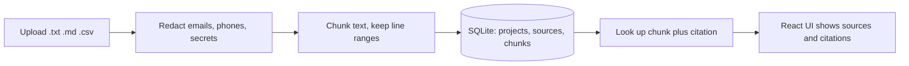
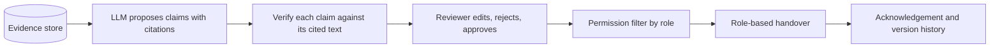

# Architecture

Baton turns authorised project sources into evidence-linked claims that a person reviews before sharing.
This document separates what **exists now** from what is **planned**.

## Components

| Component | Folder | Status |
|---|---|---|
| Backend API (FastAPI) | `backend/` | Built: upload, redaction, chunking, storage, citations |
| Database (SQLite) | `backend/app/db.py` | Built: projects, sources, chunks |
| Frontend (React + Vite + Tailwind) | `frontend/` | Built: create project, upload, view chunks and citations |
| Demo data | `demo-data/` | Built: synthetic club project with planted conflicts and gaps |
| Claim extraction (LLM) | planned | Not built |
| Verification and status labels | planned | Not built |
| Review and approval workflow | planned | Not built |
| Role-based views and permission filter | planned | Not built |

## Data flow that exists now



1. A file is uploaded to a project with an access level (`public`, `team`, `lead_only` or `restricted`).
2. Sensitive patterns are replaced before anything is stored, so raw secrets never reach the database.
3. The redacted text is split into chunks. Each chunk records its start and end line in the original file.
4. Source and chunks are saved in one transaction.
5. Any chunk can be fetched with a citation such as `notes.md, lines 14-18`.

## Planned data flow



The LLM only **proposes**. A claim without supporting evidence is shown as unverified, and nothing is shared
until a person approves it. Restricted evidence is filtered out **before** a role's view is generated.

## Evidence model (planned for claims)

Each claim will store: type, text, status (Supported, Inferred, Conflicting, Missing evidence), confidence,
a list of evidence items (source, line range, quoted span), an access level equal to the strictest level among
its evidence, the reviewer decision, and a version number.

Today's `chunks` table is the foundation for this: every future claim will point at chunk ids, and each chunk
already knows its source file, line range and access level.

## Database tables (current)

| Table | Key columns |
|---|---|
| `projects` | `id`, `name`, `created_at` |
| `sources` | `id`, `project_id`, `filename`, `kind`, `access_level`, `redactions`, `created_at` |
| `chunks` | `id`, `source_id`, `chunk_index`, `start_line`, `end_line`, `text` |

Deleting a project deletes its sources and chunks (foreign keys with `ON DELETE CASCADE`).

## Code map

```
backend/app/chunking.py    line-aware chunking
backend/app/redaction.py   pattern-based redaction
backend/app/db.py          schema and queries
backend/app/main.py        API routes
frontend/src/api.js        all backend calls
frontend/src/components/   UI pieces
```
